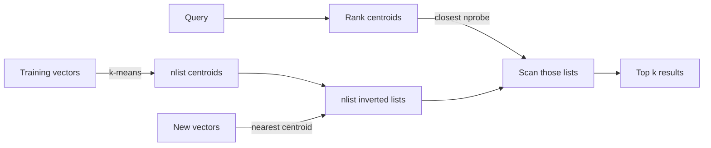
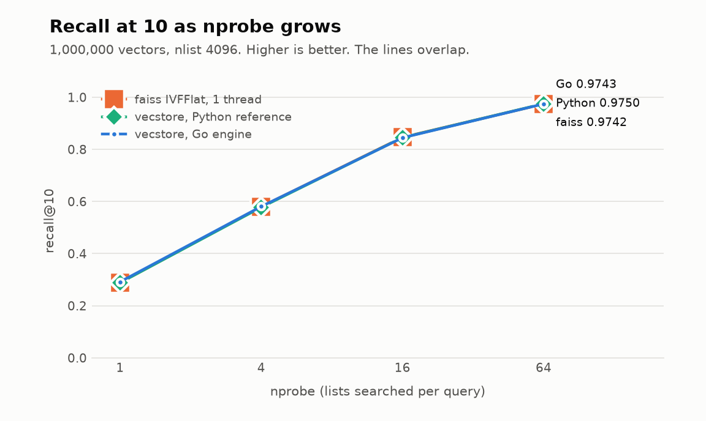
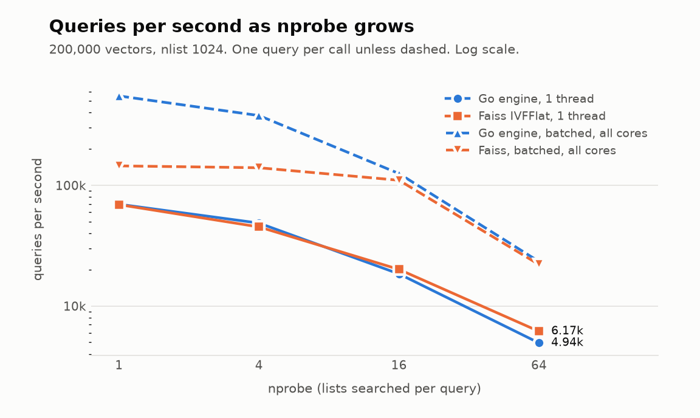

# vcdb

A small vector index built from scratch in Python and NumPy.

It finds the nearest neighbours of a query among a million vectors. It uses an IVF-Flat index. The code is short and tested. It is benchmarked against Faiss.

Everything here was written by hand. Faiss is used only as a baseline in `bench/`.

## What it does

You have many vectors. You get a new one. You want the 10 stored vectors closest to it.

The exact way compares the query with every stored vector. That is correct and slow.

An IVF index splits the space into regions first. A search visits only the closest few regions. It reads far fewer vectors. It may miss a neighbour. That trade is called recall against speed.



## Results at a glance

All numbers come from the CSV files in `results/`. The scripts that make this section read those files. Nothing is typed in by hand.

<!-- headline:start -->
- **1,000,000 vectors, nlist 4096.** Recall@10 reaches 0.975 at nprobe 64. It never differs from faiss by more than 0.0021. Faiss on one thread is 1.2x to 2.0x faster per query. Peak memory was 2,492 MB.
- **200,000 vectors, nlist 1024.** Recall@10 reaches 0.993 at nprobe 64. It never differs from faiss by more than 0.0031. Faiss on one thread is 1.9x to 2.4x faster per query. Peak memory was 2,340 MB.
<!-- headline:end -->

Dataset: `sift-128-euclidean` from ann-benchmarks. Vectors have 128 dimensions. There are 10,000 queries.
Recall@10 is the share of the true 10 nearest neighbours that the index returns.

### Recall against speed

<picture>
  <source media="(prefers-color-scheme: dark)" srcset="docs/img/recall_vs_qps_1m_dark.png">
  
</picture>

Both indexes sit on almost the same recall curve. The index design is the same. Faiss is faster at every point. Its inner loops are optimised C++.

<picture>
  <source media="(prefers-color-scheme: dark)" srcset="docs/img/recall_vs_nprobe_1m_dark.png">
  
</picture>

<picture>
  <source media="(prefers-color-scheme: dark)" srcset="docs/img/qps_vs_nprobe_1m_dark.png">
  
</picture>

The green dashed line is a reference. It shows Faiss with all queries sent in one batch on all cores. It is not a like-for-like row.

### Writes

Vectors can be added after training. The next chart shows how fast.

<picture>
  <source media="(prefers-color-scheme: dark)" srcset="docs/img/write_throughput_1m_dark.png">
  
</picture>

Adding one vector at a time is slow here. Each call has fixed Python overhead. Each call also copies a list. Bigger batches spread that cost. One run was made for each batch size.

### Build

<picture>
  <source media="(prefers-color-scheme: dark)" srcset="docs/img/build_time_1m_dark.png">
  
</picture>

<picture>
  <source media="(prefers-color-scheme: dark)" srcset="docs/img/kmeans_loss_1m_dark.png">
  
</picture>

### Tables

<!-- results:start -->
#### 1,000,000 vectors, nlist 4096

Reads

| nprobe | recall@10 vecstore | recall@10 faiss | queries/s vecstore | queries/s faiss | faiss speed over vecstore |
|---|---|---|---|---|---|
| 1 | 0.2881 | 0.2885 | 23,998 | 27,874 | 1.2x |
| 4 | 0.5777 | 0.5798 | 10,795 | 17,456 | 1.6x |
| 16 | 0.8453 | 0.8462 | 6,155 | 11,454 | 1.9x |
| 64 | 0.9750 | 0.9742 | 2,127 | 4,166 | 2.0x |

Writes after the index is built

| vectors per add call | vecstore vectors/s | faiss vectors/s |
|---|---|---|
| 1 | 1,542 | 32,234 |
| 100 | 51,513 | 36,301 |
| 1,000 | 88,319 | 306,600 |
| 10,000 | 160,166 | 315,314 |

Build

| index | train (s) | add all vectors (s) |
|---|---|---|
| vecstore | 76.5 | 3.6 |
| faiss | 67.3 | 3.6 |

#### 200,000 vectors, nlist 1024

Reads

| nprobe | recall@10 vecstore | recall@10 faiss | queries/s vecstore | queries/s faiss | faiss speed over vecstore |
|---|---|---|---|---|---|
| 1 | 0.3367 | 0.3336 | 32,173 | 73,689 | 2.3x |
| 4 | 0.6544 | 0.6517 | 16,915 | 36,236 | 2.1x |
| 16 | 0.9071 | 0.9067 | 8,067 | 19,273 | 2.4x |
| 64 | 0.9930 | 0.9931 | 2,637 | 5,014 | 1.9x |

Writes after the index is built

| vectors per add call | vecstore vectors/s | faiss vectors/s |
|---|---|---|
| 1 | 4,649 | 89,756 |
| 100 | 88,259 | 119,617 |
| 1,000 | 142,491 | 884,819 |
| 10,000 | 414,907 | 902,969 |

Build

| index | train (s) | add all vectors (s) |
|---|---|---|
| vecstore | 6.2 | 0.2 |
| faiss | 3.2 | 0.2 |

<!-- results:end -->

<details>
<summary>Charts for the 200,000 vector run</summary>

<picture>
  <source media="(prefers-color-scheme: dark)" srcset="docs/img/recall_vs_qps_200k_dark.png">
  
</picture>

<picture>
  <source media="(prefers-color-scheme: dark)" srcset="docs/img/qps_vs_nprobe_200k_dark.png">
  
</picture>

<picture>
  <source media="(prefers-color-scheme: dark)" srcset="docs/img/write_throughput_200k_dark.png">
  
</picture>

<picture>
  <source media="(prefers-color-scheme: dark)" srcset="docs/img/build_time_200k_dark.png">
  
</picture>

</details>

## How it was checked

The brute-force index in `vecstore/flat.py` is the oracle. It is compared with a plain Python loop.

The IVF index is tested against the oracle. These checks run in `tests/`:

- With `nprobe` equal to `nlist`, the results equal brute force exactly.
- A stored vector searched alone returns itself first.
- Vectors added after training are found.
- Recall rises as `nprobe` rises.
- The k-means loss falls on every iteration of a synthetic set.
- Empty lists, custom ids and use before training behave as expected.

```
$ make test
============================= test session starts ==============================
platform darwin -- Python 3.13.17, pytest-9.2.0, pluggy-1.7.0
collected 17 items
tests/test_flat.py ......                                                [ 35%]
tests/test_ivf.py .......                                                [ 76%]
tests/test_kmeans.py ....                                                [100%]
============================== 17 passed in 0.20s ==============================
```

The ground truth for the benchmark comes from the oracle. It was cross-checked against `faiss.IndexFlatL2` on 1,000 queries. The two differ only where two vectors sit at the exact same distance. Both answers are right in those cases.

## Fair comparison

- Both indexes train on the same vectors.
- Both use the same `nlist` and 20 k-means iterations.
- Query speed is measured one query per call. It is the median of three passes over 10,000 queries.
- Faiss is held to one thread for that measurement.
- Insert speed is one run per batch size. Faiss is also held to one thread.
- Build time uses default threads for both.
- NumPy's own BLAS threads are not pinned.

Recall is close but not identical. The two k-means runs start from different points. The lists differ a little.

## Limits

- Python is slower than C++. Faiss wins on speed in nearly every row.
- Search loops over queries in Python. A query batch gets no speed-up.
- Memory use is not tuned. Vectors are stored as float32 with no compression.
- Results come from one machine, an Apple M4 Pro. Numbers will differ elsewhere.
- No claim is made of a new idea. No claim is made of beating Faiss.

## Layout

```
vecstore/
  flat.py      brute-force search and the shared top-k helper
  kmeans.py    Lloyd's k-means with fixed seeds
  ivf.py       IVF-Flat: train, add, search
tests/         correctness tests
bench/
  fetch.py     downloads the dataset after checking its size
  compare.py   benchmark against faiss.IndexIVFFlat
  plot.py      draws the charts from results/
results/       CSV files. The only source of numbers
docs/          walkthrough and chart images
tools/         builds OVERVIEW.md and the tables above
```

## Run it

Tested on macOS with Python 3.13. Other platforms were not tried.

```
make setup     # create .venv and install packages
make test      # run the tests
make fetch     # download the dataset (about 525 MB)
make bench     # 200,000 vector benchmark
make plots     # redraw the charts
make status    # rebuild OVERVIEW.md and the tables above
```

The 1,000,000 vector run:

```
.venv/bin/python bench/compare.py --n 1000000 --nlist 4096
```

## Read more

- [`docs/walkthrough.md`](docs/walkthrough.md) explains the code in plain sentences.
- [`OVERVIEW.md`](OVERVIEW.md) holds the status of each piece of work.
- [`ENVIRONMENT.md`](ENVIRONMENT.md) lists the exact versions and the dataset check.

## Status

Planned and not built: a mini-batch k-means trainer and a note on HNSW. Both are optional.

## Licence

MIT.
