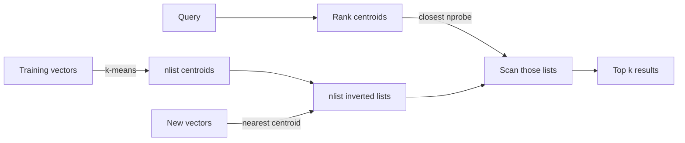
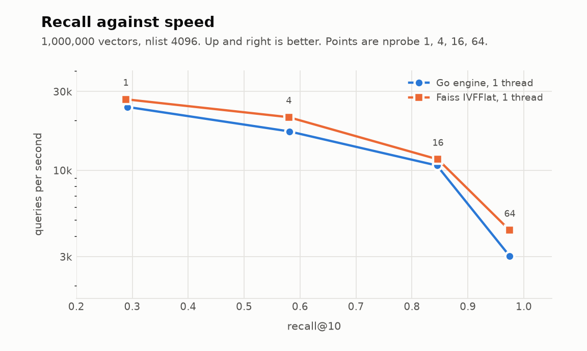
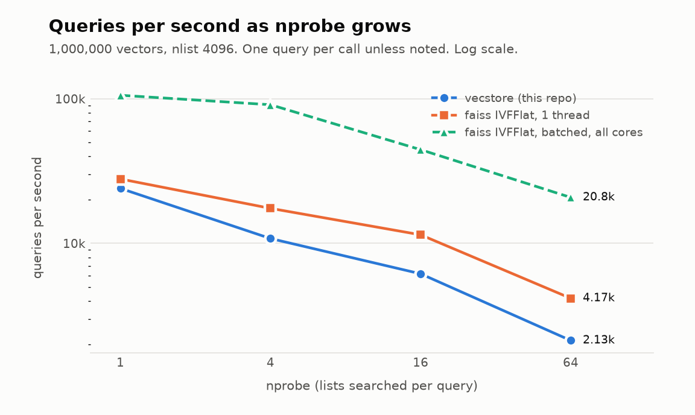
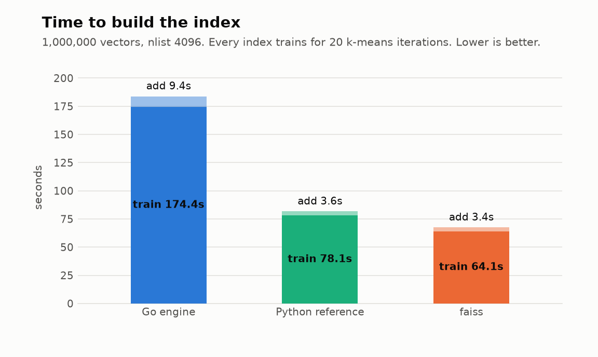
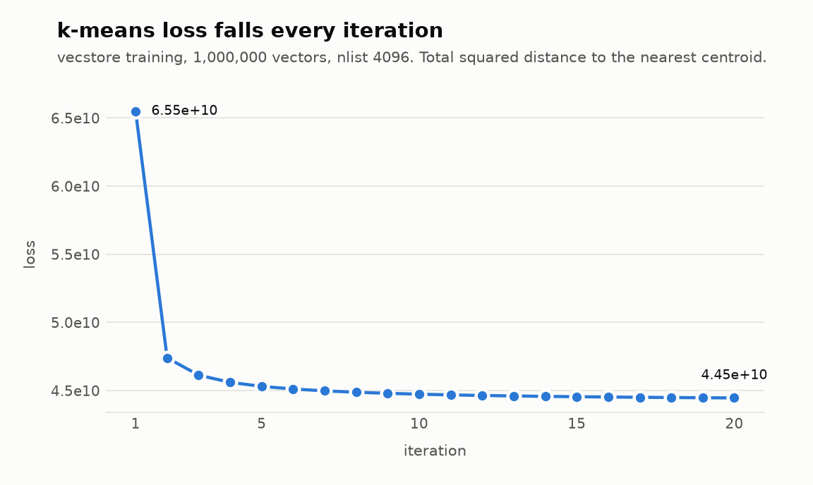
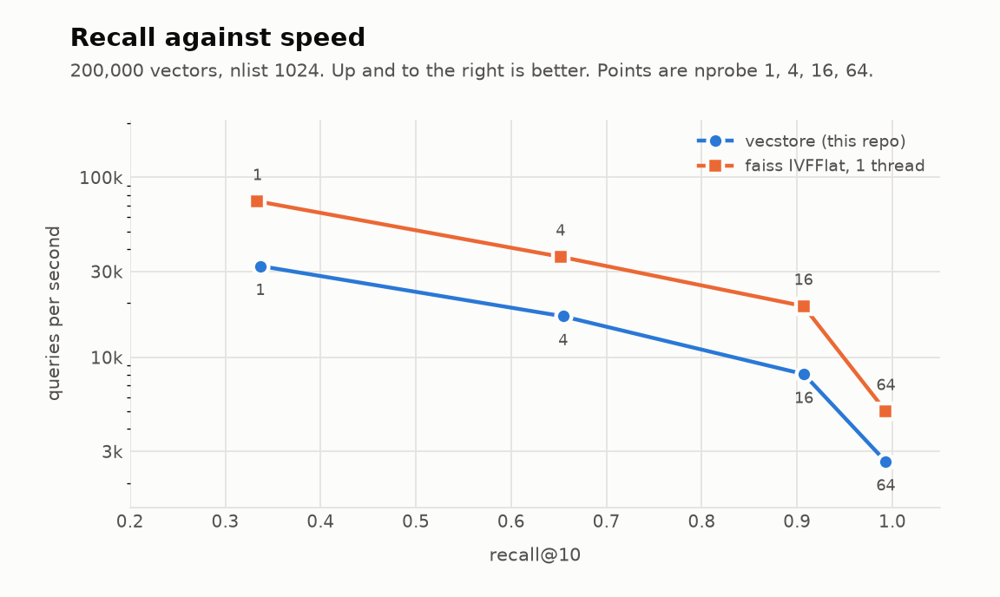
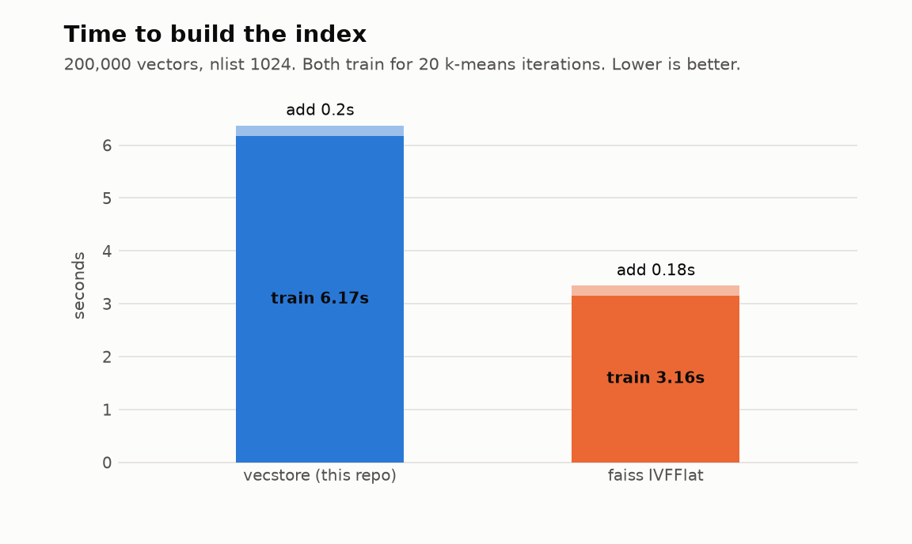

# vcdb

[](https://github.com/sptsway/vcdb/actions/workflows/ci.yml)

A small vector index written from scratch in Go.

It finds the nearest neighbours of a query among a million vectors. It uses an IVF-Flat index. The hot loops are written in arm64 assembly. A portable Go version runs everywhere else.

Python is used only for the benchmark. It runs Faiss, the baseline, and draws the charts.

## What it does

You have many vectors. You get a new one. You want the 10 stored vectors closest to it.

The exact way compares the query with every stored vector. That is correct and slow.

An IVF index splits the space into regions first. A search visits only the closest few regions. It reads far fewer vectors. It may miss a neighbour. That trade is called recall against speed.



Using it from Go:

```go
ix := engine.NewIVF(128, 1024, 0)  // dimension, number of lists, seed
ix.Train(sample, 20, 0)            // vectors, k-means rounds, workers (0 = all cores)
ix.Add(vectors, nil, 0)            // callable again at any later time
hits := ix.Search(query, 10, 16)   // query, k, nprobe
fmt.Println(hits[0].ID, hits[0].Dist)
```

## Results at a glance

Two implementations are compared.

- **Go engine.** The main project.
- **Faiss.** `faiss.IndexIVFFlat`, the baseline.

All numbers come from the CSV files in `results/`. The scripts that make this section read those files. Nothing is typed in by hand.

<!-- headline:start -->
- **1,000,000 vectors, nlist 4096.** The Go engine reaches recall@10 of 0.975 at nprobe 64. It never differs from faiss by more than 0.0030. On one thread it runs at 70% to 92% of faiss's query speed. Training takes 1.9x as long as faiss. Peak memory was 1,688 MB.
- **200,000 vectors, nlist 1024.** The Go engine reaches recall@10 of 0.994 at nprobe 64. It never differs from faiss by more than 0.0030. On one thread it runs at 80% to 108% of faiss's query speed. Training takes 1.9x as long as faiss. Peak memory was 470 MB.
<!-- headline:end -->

Dataset: `sift-128-euclidean` from ann-benchmarks. Vectors have 128 dimensions. There are 10,000 queries.
Recall@10 is the share of the true 10 nearest neighbours that the index returns.

### Recall against speed

<picture>
  <source media="(prefers-color-scheme: dark)" srcset="docs/img/recall_vs_qps_1m_dark.png">
  
</picture>

The two indexes sit on almost the same recall curve. They use the same design. Only the speed differs.

<picture>
  <source media="(prefers-color-scheme: dark)" srcset="docs/img/recall_vs_nprobe_1m_dark.png">
  
</picture>

<picture>
  <source media="(prefers-color-scheme: dark)" srcset="docs/img/qps_vs_nprobe_1m_dark.png">
  
</picture>

Solid lines send one query per call on one thread. Dashed lines send all queries in one batch and use every core. Compare solid with solid, dashed with dashed.

### Writes

Vectors can be added after training. The next chart shows how fast.

<picture>
  <source media="(prefers-color-scheme: dark)" srcset="docs/img/write_throughput_1m_dark.png">
  
</picture>

Each add call finds the nearest centroid of every new vector. That is the main cost. Bigger batches spread the fixed per-call cost. Dashed lines let the index use every core. One run was made for each batch size.

### Build

<picture>
  <source media="(prefers-color-scheme: dark)" srcset="docs/img/build_time_1m_dark.png">
  
</picture>

Training is where the Go engine is slowest. K-means is one huge matrix product, repeated. Faiss hands that product to a tuned matrix library. The Go engine computes it with its own vector loops, one point at a time.

<picture>
  <source media="(prefers-color-scheme: dark)" srcset="docs/img/kmeans_loss_1m_dark.png">
  
</picture>

### Tables

<!-- results:start -->
#### 1,000,000 vectors, nlist 4096

Reads

Recall@10

| nprobe | Go | faiss |
|---|---|---|
| 1 | 0.2915 | 0.2885 |
| 4 | 0.5807 | 0.5798 |
| 16 | 0.8447 | 0.8464 |
| 64 | 0.9749 | 0.9748 |

Queries per second. One query per call, one thread, unless marked batched.

| nprobe | Go | faiss | Go batched, all cores | faiss batched, all cores | faiss speed over Go |
|---|---|---|---|---|---|
| 1 | 24,206 | 26,940 | 176,594 | 128,381 | 1.11x |
| 4 | 17,216 | 20,992 | 120,140 | 109,612 | 1.22x |
| 16 | 10,702 | 11,658 | 74,083 | 67,389 | 1.09x |
| 64 | 3,022 | 4,336 | 16,513 | 21,953 | 1.43x |

A faiss-over-Go value below 1.00x means the Go engine is faster.

Writes after the index is built. Vectors per second. One thread unless marked all cores.

| vectors per add call | Go | faiss | Go, all cores | faiss, all cores |
|---|---|---|---|---|
| 1 | 15,873 | 20,546 | n/a | 7,019 |
| 100 | 21,382 | 25,907 | 166,765 | 140,774 |
| 1,000 | 24,485 | 223,282 | 195,650 | 287,000 |
| 10,000 | 27,070 | 229,810 | 195,209 | 303,646 |

Build. Every index trains for the same number of k-means iterations.

| index | train (s) | add all vectors (s) |
|---|---|---|
| Go | 120.4 | 6.6 |
| faiss | 63.0 | 3.3 |

#### 200,000 vectors, nlist 1024

Reads

Recall@10

| nprobe | Go | faiss |
|---|---|---|
| 1 | 0.3349 | 0.3336 |
| 4 | 0.6547 | 0.6517 |
| 16 | 0.9063 | 0.9067 |
| 64 | 0.9935 | 0.9931 |

Queries per second. One query per call, one thread, unless marked batched.

| nprobe | Go | faiss | Go batched, all cores | faiss batched, all cores | faiss speed over Go |
|---|---|---|---|---|---|
| 1 | 69,723 | 69,203 | 550,600 | 144,974 | 0.99x |
| 4 | 48,656 | 45,237 | 378,675 | 139,919 | 0.93x |
| 16 | 18,463 | 20,106 | 125,246 | 110,202 | 1.09x |
| 64 | 4,943 | 6,167 | 23,355 | 22,060 | 1.25x |

A faiss-over-Go value below 1.00x means the Go engine is faster.

Writes after the index is built. Vectors per second. One thread unless marked all cores.

| vectors per add call | Go | faiss | Go, all cores | faiss, all cores |
|---|---|---|---|---|
| 1 | 57,069 | 66,466 | n/a | 7,005 |
| 100 | 69,310 | 82,982 | 311,053 | 259,000 |
| 1,000 | 70,094 | 614,842 | 536,615 | 867,761 |
| 10,000 | 75,218 | 575,053 | 749,733 | 965,795 |

Build. Every index trains for the same number of k-means iterations.

| index | train (s) | add all vectors (s) |
|---|---|---|
| Go | 6.1 | 0.4 |
| faiss | 3.2 | 0.2 |

<!-- results:end -->

<details>
<summary>Charts for the 200,000 vector run</summary>

<picture>
  <source media="(prefers-color-scheme: dark)" srcset="docs/img/recall_vs_qps_200k_dark.png">
  
</picture>

<picture>
  <source media="(prefers-color-scheme: dark)" srcset="docs/img/qps_vs_nprobe_200k_dark.png">
  
</picture>

<picture>
  <source media="(prefers-color-scheme: dark)" srcset="docs/img/write_throughput_200k_dark.png">
  
</picture>

<picture>
  <source media="(prefers-color-scheme: dark)" srcset="docs/img/build_time_200k_dark.png">
  
</picture>

</details>

## How the Go engine works

The engine is in `engine/`. It has no dependencies outside the standard library.

- `distance.go` has the one squared-L2 function every index uses.
- `topk.go` has a bounded heap that keeps the best k results. Ties go to the smaller id.
- `flat.go` is the exact brute-force index and the oracle for the tests.
- `centroids.go` and `kmeans.go` train the regions. Results are the same for any worker count.
- `ivf.go` is the index. Many goroutines can search at once.
- `simd_arm64.s` holds the assembly kernels.

### Why there is assembly

A first Go version ran slower than expected. A profile showed the distance loop handling about one number per cycle. The Go compiler does not use vector instructions by itself.

Apple chips have NEON, which works on four numbers per instruction. Three kernels are written directly in assembly: one distance, four distances at once, and a dot product against four centroids.

Each kernel has a plain Go twin. Tests compare the two on many lengths. The four-at-once kernel must give the same bits as the one-at-a-time kernel. That keeps exact comparisons with the brute-force index valid.

Search also splits work across cores in small chunks handed out on demand. Equal slices left the fast cores waiting for the slow ones.

On other CPUs the plain Go loops run. The build tag `purego` forces them.

## How it was checked

The brute-force index is the oracle. The IVF index is tested against it. These checks run for the Go engine:

- With `nprobe` equal to `nlist`, ids and distances equal brute force exactly.
- A stored vector searched alone returns itself first.
- Vectors added after training are found, in one call or several.
- Recall rises as `nprobe` rises.
- The k-means loss falls on every iteration.
- The worker count never changes a result.
- Each assembly kernel matches its plain Go twin.
- Many goroutines searching at once get the same answers.

Go tests run with the race detector. CI runs them on Linux (amd64) and on macOS (arm64), and again with assembly switched off.

CI caught a real bug while this was being built. The assembly did not build on Go 1.23 because it used instruction names that older assemblers lack. It is fixed, and the build is now tested on that version.

The ground truth for the benchmark comes from `faiss.IndexFlatL2`. The Go exact index is checked against it on 500 queries. They differ only where two vectors sit at the exact same distance. Both answers are right in those cases.

## Fair comparison

- Both indexes train on the same vectors.
- Both use the same `nlist` and 20 k-means iterations.
- Query speed is one query per call. Faiss is held to one thread. The Go engine uses one goroutine.
- Each speed is the fastest of seven passes over 10,000 queries. Other programs can only slow a pass down.
- Insert speed is one run per batch size.
- Build time uses default threads for both.
- Go's garbage collector can use other cores.

Recall is close but not identical. The k-means runs start from different points. The lists differ a little.

The benchmark machine was a normal desktop with other programs open. An earlier run of the same code gave speeds that differed by up to a factor of two between runs. That is why the fastest of seven passes is reported. Treat differences of about 10 percent as noise.

## Limits

- The assembly was tested on one chip, an Apple M4 Pro. Other arm64 chips are untested.
- The portable path is tested in CI on Linux amd64. It was not benchmarked there.
- Training is slower than in Faiss.
- Faiss is faster for large insert batches.
- Only squared L2 distance and float32 vectors are supported.
- No deletion and no saving to disk.
- `Add` and `Train` must not run at the same time as a search.
- Results come from one machine. Numbers will differ elsewhere.
- No claim is made of a new idea. No claim is made of beating Faiss.

## Layout

```
engine/            the Go engine (module github.com/sptsway/vcdb/engine)
  flat.go          brute-force index
  topk.go          bounded heap
  kmeans.go        Lloyd's k-means
  ivf.go           IVF-Flat index
  simd_arm64.s     NEON kernels
  cmd/vcbench/     benchmark binary
bench/
  fetch.py         downloads the dataset after checking its size
  export_data.py   writes vectors and true neighbours as raw files
  groundtruth.py   exact neighbours from faiss.IndexFlatL2
  compare.py       Faiss benchmark
  plot.py          draws the charts from results/
results/           CSV files. The only source of numbers
docs/              walkthrough and chart images
tools/             builds OVERVIEW.md and the tables above
```

## Run it

Needs Go 1.23 or newer. The Python harness needs Python 3.13. Tested on macOS only.

```
make test       # Go tests with the race detector
make setup      # create .venv and install the benchmark packages
make fetch      # download the dataset (about 525 MB)
make bench-all  # 200,000 vectors: Faiss, then Go
make plots      # redraw the charts
make status     # rebuild OVERVIEW.md and the tables above
```

The 1,000,000 vector run:

```
.venv/bin/python bench/compare.py --n 1000000 --nlist 4096
.venv/bin/python bench/export_data.py --n 1000000
cd engine && go run ./cmd/vcbench -dir ../data/export/1m -tag 1m -nlist 4096 -out ../results
```

## Read more

- [`docs/walkthrough.md`](docs/walkthrough.md) explains the code in plain sentences.
- [`OVERVIEW.md`](OVERVIEW.md) holds the status of each piece of work.
- [`ENVIRONMENT.md`](ENVIRONMENT.md) lists the exact versions and the dataset check.

## Status

Planned and not built: a mini-batch k-means trainer, a note on HNSW, and a tiled kernel to speed up training. All are optional.

## Licence

MIT.
