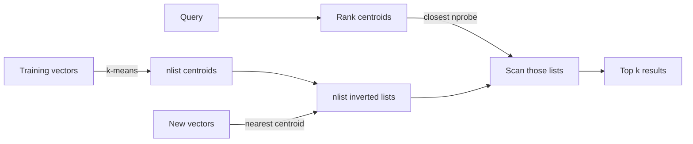
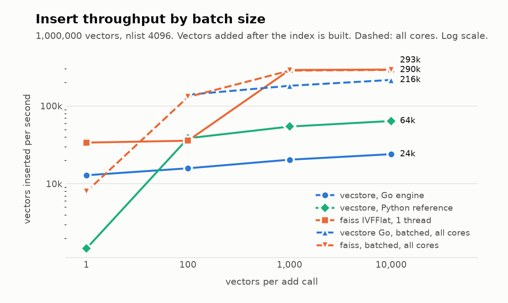
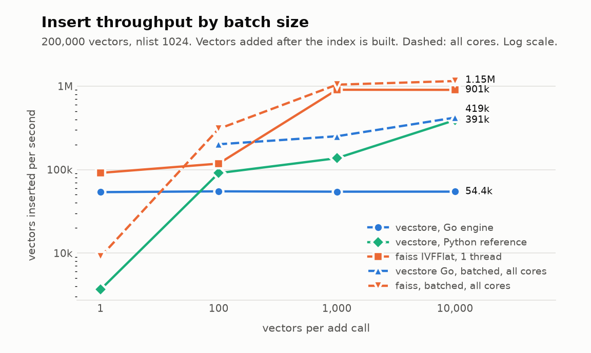

# vcdb

[](https://github.com/sptsway/vcdb/actions/workflows/ci.yml)

**A vector search index written from scratch in Go. It is tested against an exact oracle and benchmarked against Faiss.**

Vector search finds the stored items most similar to a query. It powers semantic search, recommendations and retrieval for language models. This project builds the core of such a system: an IVF-Flat index.

It asks two questions. Is the index correct? How close does it get to Faiss, the reference library from Meta?

## At a glance

Dataset: `sift-128-euclidean` from ann-benchmarks. Each vector has 128 numbers. Every test uses 10,000 queries.

<!-- headline:start -->
|  | 1,000,000 vectors | 200,000 vectors |
|---|---|---|
| Lists (nlist) | 4096 | 1024 |
| Go recall@10 at nprobe 64 | 0.975 | 0.994 |
| Largest recall gap to Faiss | 0.0030 | 0.0030 |
| Go query speed on one thread, as a share of Faiss | 70% to 92% | 80% to 108% |
| Go training time, compared with Faiss | 1.9x as long | 1.9x as long |
| Go peak memory | 1,688 MB | 470 MB |
<!-- headline:end -->

Recall@10 is the share of the true 10 nearest neighbours that the index finds. Every number on this page is read from the CSV files in `results/`. None is typed in by hand.

<picture>
  <source media="(prefers-color-scheme: dark)" srcset="docs/img/recall_vs_qps_1m_dark.png">
  
</picture>

The Go engine finds the same neighbours as Faiss. On one thread it answers queries at close to Faiss's speed.

## Highlights

- **Correct by construction.** A brute-force index is the reference. With every list searched, the fast index must give the brute-force answer. Each distance must match to the last bit.
- **Optimised from evidence.** The first Go version was slower than expected. A profile showed the distance loop handling one number per CPU cycle. Three small kernels in arm64 assembly fixed that. Each one is tested against a plain Go version.
- **Benchmarked honestly.** Both indexes get the same data and the same settings. The places where Faiss wins are shown, not hidden.
- **Checked on every change.** Tests run with Go's race detector. CI runs them on Linux and macOS. CI caught one real bug: the assembly did not build on an older Go version.

## How it works

Searching a million vectors one by one is exact but slow. An IVF index groups the vectors first.

1. **Train.** K-means splits the space into `nlist` regions. Each region has a centre, called a centroid.
2. **Add.** Each vector goes into the list of its nearest centroid. Vectors can be added at any time after training.
3. **Search.** The query is compared with every centroid. Only the closest `nprobe` lists are scanned in full.

A small `nprobe` is fast but may miss a neighbour. A large `nprobe` is slower and more accurate. This is the recall-speed trade-off shown in the charts.



Using it from Go:

```go
ix := engine.NewIVF(128, 1024, 0)  // dimension, number of lists, seed
ix.Train(sample, 20, 0)            // vectors, k-means rounds, workers (0 = all cores)
ix.Add(vectors, nil, 0)            // can be called again later
hits := ix.Search(query, 10, 16)   // query, k, nprobe
fmt.Println(hits[0].ID, hits[0].Dist)
```

### The code

The engine lives in `engine/`. It uses only Go's standard library.

| File | What it does |
|---|---|
| `distance.go` | The one distance function every index uses |
| `topk.go` | A small heap that keeps the best k results |
| `flat.go` | Exact brute-force search, used as the reference in tests |
| `centroids.go`, `kmeans.go` | K-means training |
| `ivf.go` | The IVF index: train, add, search |
| `simd_arm64.s` | Assembly kernels for Apple and other arm64 chips |

### Why there is assembly

Go's compiler does not use the CPU's vector instructions on its own. So a plain Go loop handles one number at a time.

Apple chips have NEON. One NEON instruction works on four numbers at once. Three kernels use it:

- one distance between two vectors
- four distances at once, from one query to four vectors
- four dot products at once, from one vector to four centroids

Each kernel has a plain Go twin. Tests compare the two. The four-at-once kernel must give the same bits as four single calls. This keeps the exact comparison with brute force valid.

On other CPUs the plain Go loops run. The build tag `purego` forces them for testing.

## Results

Solid lines send one query per call on one thread. Dashed lines send all queries at once and use every core. Compare solid with solid and dashed with dashed.

<picture>
  <source media="(prefers-color-scheme: dark)" srcset="docs/img/recall_vs_nprobe_1m_dark.png">
  
</picture>

The two recall lines overlap. Both indexes use the same method.

<picture>
  <source media="(prefers-color-scheme: dark)" srcset="docs/img/qps_vs_nprobe_1m_dark.png">
  
</picture>

On one thread, Faiss is faster on this million-vector set. The gap is widest at large `nprobe`. On all cores, the Go engine leads at small `nprobe`.

<picture>
  <source media="(prefers-color-scheme: dark)" srcset="docs/img/write_throughput_1m_dark.png">
  
</picture>

Each insert must find the nearest centroid of the new vector. Faiss does this faster for large batches. It hands the work to a tuned matrix library. Single-vector adds are the slowest case: each compares the new vector with all 4,096 centroids on one core.

<picture>
  <source media="(prefers-color-scheme: dark)" srcset="docs/img/build_time_1m_dark.png">
  
</picture>

Training is the Go engine's weakest point. K-means repeats one large matrix product. Faiss uses a tuned matrix library for it. The Go engine uses its own loops, one point at a time.

<picture>
  <source media="(prefers-color-scheme: dark)" srcset="docs/img/kmeans_loss_1m_dark.png">
  
</picture>

The k-means loss falls on every round, as theory says it must.

### Full tables

<!-- results:start -->
<details>
<summary><b>1,000,000 vectors, nlist 4096</b></summary>

**Recall@10**

| nprobe | Go | Faiss |
|---|---|---|
| 1 | 0.2915 | 0.2885 |
| 4 | 0.5807 | 0.5798 |
| 16 | 0.8447 | 0.8464 |
| 64 | 0.9749 | 0.9748 |

**Queries per second.** One query per call on one thread, unless marked all cores.

| nprobe | Go | Faiss | Go, all cores | Faiss, all cores | Faiss ÷ Go |
|---|---|---|---|---|---|
| 1 | 24,206 | 26,940 | 176,594 | 128,381 | 1.11x |
| 4 | 17,216 | 20,992 | 120,140 | 109,612 | 1.22x |
| 16 | 10,702 | 11,658 | 74,083 | 67,389 | 1.09x |
| 64 | 3,022 | 4,336 | 16,513 | 21,953 | 1.43x |

Faiss ÷ Go compares the one-thread columns. Below 1.00x, Go is faster.

**Inserts after the index is built.** Vectors per second. One thread unless marked all cores.

| Vectors per call | Go | Faiss | Go, all cores | Faiss, all cores |
|---|---|---|---|---|
| 1 | 15,873 | 20,546 | n/a | 7,019 |
| 100 | 21,382 | 25,907 | 166,765 | 140,774 |
| 1,000 | 24,485 | 223,282 | 195,650 | 287,000 |
| 10,000 | 27,070 | 229,810 | 195,209 | 303,646 |

**Build time.** Both train for the same number of k-means rounds.

| Index | Train (s) | Add all vectors (s) |
|---|---|---|
| Go | 120.4 | 6.6 |
| Faiss | 63.0 | 3.3 |

</details>

<details>
<summary><b>200,000 vectors, nlist 1024</b></summary>

**Recall@10**

| nprobe | Go | Faiss |
|---|---|---|
| 1 | 0.3349 | 0.3336 |
| 4 | 0.6547 | 0.6517 |
| 16 | 0.9063 | 0.9067 |
| 64 | 0.9935 | 0.9931 |

**Queries per second.** One query per call on one thread, unless marked all cores.

| nprobe | Go | Faiss | Go, all cores | Faiss, all cores | Faiss ÷ Go |
|---|---|---|---|---|---|
| 1 | 69,723 | 69,203 | 550,600 | 144,974 | 0.99x |
| 4 | 48,656 | 45,237 | 378,675 | 139,919 | 0.93x |
| 16 | 18,463 | 20,106 | 125,246 | 110,202 | 1.09x |
| 64 | 4,943 | 6,167 | 23,355 | 22,060 | 1.25x |

Faiss ÷ Go compares the one-thread columns. Below 1.00x, Go is faster.

**Inserts after the index is built.** Vectors per second. One thread unless marked all cores.

| Vectors per call | Go | Faiss | Go, all cores | Faiss, all cores |
|---|---|---|---|---|
| 1 | 57,069 | 66,466 | n/a | 7,005 |
| 100 | 69,310 | 82,982 | 311,053 | 259,000 |
| 1,000 | 70,094 | 614,842 | 536,615 | 867,761 |
| 10,000 | 75,218 | 575,053 | 749,733 | 965,795 |

**Build time.** Both train for the same number of k-means rounds.

| Index | Train (s) | Add all vectors (s) |
|---|---|---|
| Go | 6.1 | 0.4 |
| Faiss | 3.2 | 0.2 |

</details>
<!-- results:end -->

<details>
<summary><b>Charts for 200,000 vectors</b></summary>

<picture>
  <source media="(prefers-color-scheme: dark)" srcset="docs/img/recall_vs_qps_200k_dark.png">
  
</picture>

<picture>
  <source media="(prefers-color-scheme: dark)" srcset="docs/img/qps_vs_nprobe_200k_dark.png">
  
</picture>

<picture>
  <source media="(prefers-color-scheme: dark)" srcset="docs/img/write_throughput_200k_dark.png">
  
</picture>

<picture>
  <source media="(prefers-color-scheme: dark)" srcset="docs/img/build_time_200k_dark.png">
  
</picture>

</details>

## How it was checked

The brute-force index is the reference. These tests run on every change:

- With every list searched, the IVF results equal brute force exactly.
- A stored vector, searched for, comes back first.
- Vectors added after training are found.
- Recall rises as `nprobe` rises.
- The k-means loss never rises between rounds.
- The number of CPU cores never changes a result.
- Each assembly kernel matches its plain Go twin.
- Many searches running at once get the same answers.

CI runs the tests on Linux and macOS. It runs them again with the assembly switched off.

The benchmark's true neighbours come from Faiss's exact index. The Go brute-force index agrees with them on every sampled query.

## Fair comparison

- Both indexes train on the same vectors.
- Both use the same number of lists and 20 k-means rounds.
- One-thread speed is one query per call. Faiss is held to one thread.
- Each speed is the best of seven passes over all queries. Other programs on the machine can only slow a pass down.
- Insert speed is one run per batch size.
- Build time lets both use every core.

Recall is close but not identical. The two k-means runs start from different points. So their lists differ a little.

The benchmarks ran on a normal desktop with other programs open. Speeds varied between runs. Treat differences of about 10 percent as noise.

## Limits

- The benchmarks ran on one machine, an Apple M4 Pro. Numbers will differ elsewhere.
- The assembly was benchmarked on that chip only. CI also tests it on GitHub's arm64 Macs.
- Training takes longer than in Faiss.
- Faiss inserts large batches faster.
- Only Euclidean distance and 32-bit floats are supported.
- There is no deletion and no saving to disk.
- `Add` and `Train` must not run during a search.
- This project claims no new method. It does not claim to beat Faiss.

## Roadmap

The core index is built. The next steps make it faster, smaller and more complete. The long-term goal is a small vector database.

<!-- roadmap:start -->
**Core index**

- [x] Exact search as the correctness reference
- [x] IVF-Flat index with k-means training
- [x] NEON assembly kernels with a portable Go fallback
- [x] Benchmark against Faiss on one million vectors

**Speed**

- [ ] Tiled kernel for faster k-means training
- [ ] Mini-batch k-means for faster training on large datasets
- [ ] AVX2 kernels for x86 CPUs

**Memory**

- [ ] Product quantization (IVF-PQ) to store vectors in a fraction of the memory

**More index types**

- [ ] HNSW graph index measured against IVF on the same benchmark

**From index to database**

- [ ] Save and load the index from disk
- [ ] Delete and update vectors
- [ ] Search filtered by metadata
- [ ] A small network service so other programs can query it
<!-- roadmap:end -->

## Run it

Needs Go 1.23 or newer. The benchmark scripts need Python 3.13.

```
make test       # run the Go tests with the race detector
make setup      # create .venv for the benchmark scripts
make fetch      # download the dataset (about 525 MB)
make bench-all  # 200,000 vectors: Faiss first, then Go
make plots      # redraw the charts
make status     # rebuild OVERVIEW.md and the tables on this page
```

The 1,000,000 vector run:

```
.venv/bin/python bench/compare.py --n 1000000 --nlist 4096
.venv/bin/python bench/export_data.py --n 1000000
cd engine && go run ./cmd/vcbench -dir ../data/export/1m -tag 1m -nlist 4096 -out ../results
```

## Project layout

```
engine/            the Go engine
  cmd/vcbench/     benchmark program for the engine
bench/             Python scripts: dataset, Faiss baseline, charts
results/           CSV files, the only source of numbers
docs/              walkthrough and chart images
tools/             builds OVERVIEW.md and the tables on this page
```

## Read more

- [`docs/walkthrough.md`](docs/walkthrough.md) explains the code in plain sentences.
- [`OVERVIEW.md`](OVERVIEW.md) shows the status of each part.
- [`ENVIRONMENT.md`](ENVIRONMENT.md) lists the exact versions and the dataset check.

## Licence

MIT.
